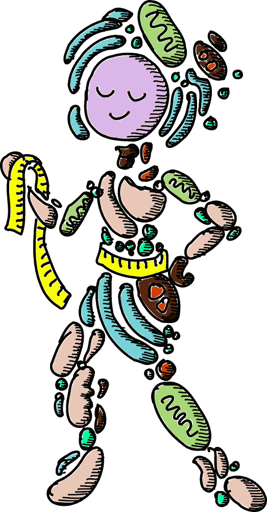
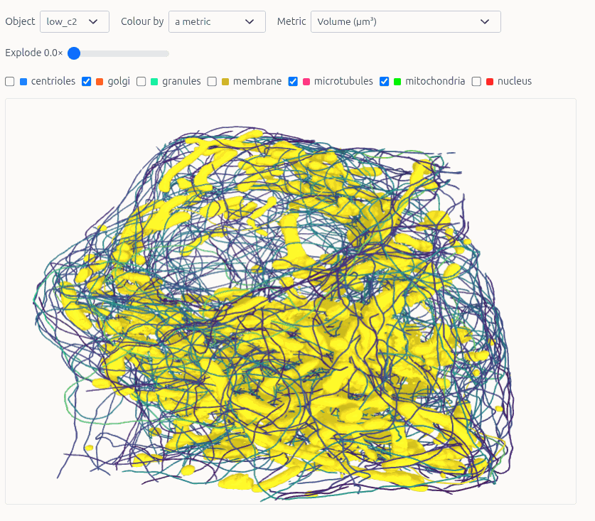
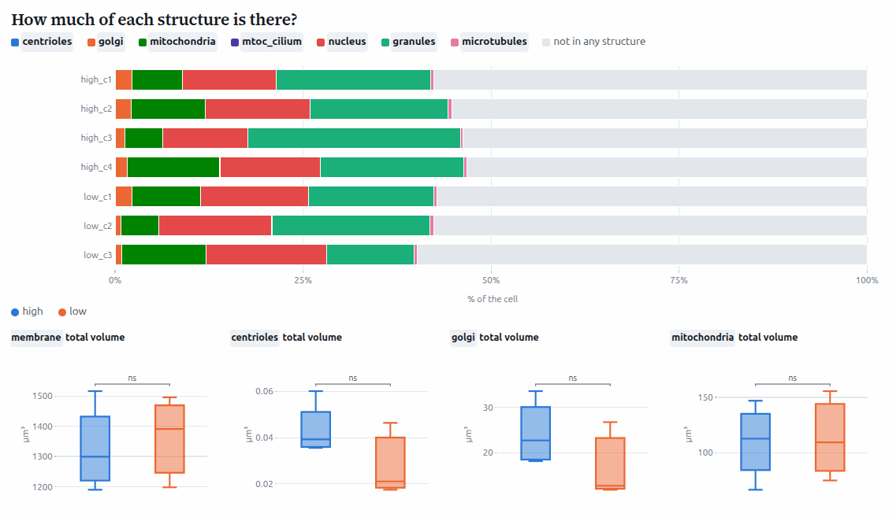
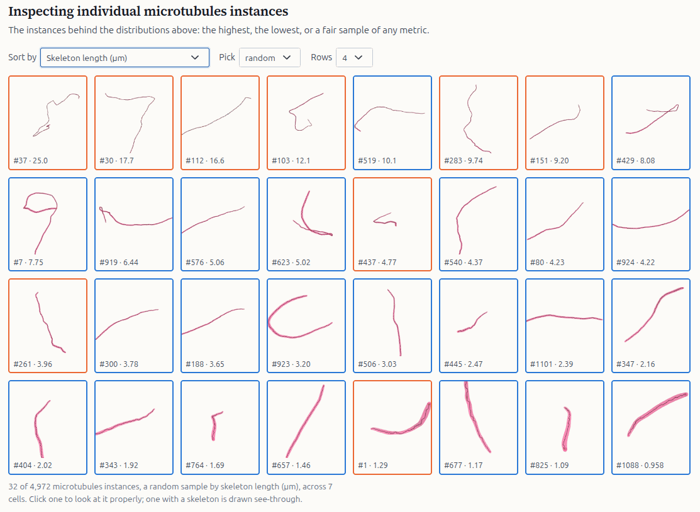
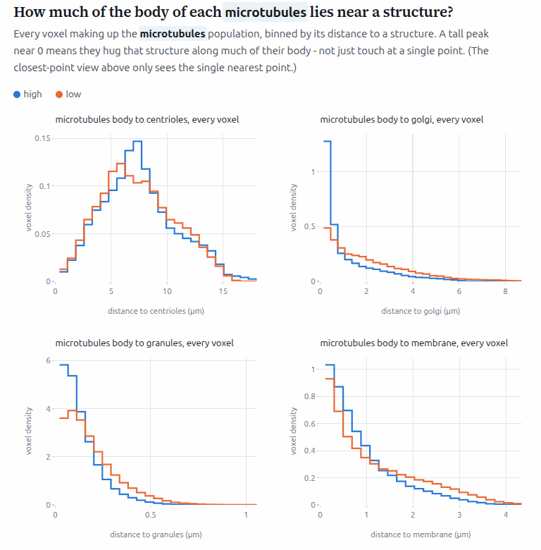

# Organella: measuring label relationships in 3D



Organella measures segmented objects - 2D or 3D, one or a batch of them - and produces a
single report including distributions, distances, contacts, and 3D visualizations. 
This project is targeting, but not limited to the study of 3D structures in single cells.

### Online viewer:  https://ida-mdc.github.io/organella/

The online viewer can be used to visualize local report files. It does not upload any data to a remote location, it runs locally in the browser.

### Example report: **[seven mouse β cells, from Müller et al.](https://ida-mdc.github.io/organella/?data=https%3A%2F%2Fdcache-doma-door01.desy.de%2FHelmholtz%2FHIP%2Fcollaborations%2FOrganella%2Freports%2Fmueller-betacells.parquet)**

FIB-SEM, seven cells grouped in two conditions (stimulated with low and high glucose) and
segmented into plasma membrane, nucleus, Golgi apparatus, mitochondria, insulin secretory
granules, microtubules, centrioles and axoneme.

Or try the viewer on two synthetic datasets with known answers, in [3D](https://ida-mdc.github.io/organella/?data=examples/synthetic-3d.parquet) and in [2D](https://ida-mdc.github.io/organella/?data=examples/synthetic-2d.parquet) (made by the tests, not biology).

<br clear="right">

## Screenshots from the reports

|  |  |
| --- | --- |
| [](https://raw.githubusercontent.com/ida-mdc/organella/main/docs/report-3d.png)<br>**The object in 3D**, with `--with-mesh`. | [](https://raw.githubusercontent.com/ida-mdc/organella/main/docs/report-distributions.png)<br>**Composition, and groups compared**, with plots for shape and relationship metrics. |
| [](https://raw.githubusercontent.com/ida-mdc/organella/main/docs/report-instances.png)<br>**A gallery of individual instances**, sortable by any metric, with inspectable skeletons. | [](https://raw.githubusercontent.com/ida-mdc/organella/main/docs/report-voxel-distances.png)<br>**A structure's voxels binned by distance** to another structure. |

## Workflow

1. Organise your images in one of the [input layouts](#your-input).
2. `organella dry-run` to check what will be analysed.
3. `organella process` to write `report.parquet` and, with `--with-mesh`, the geometry.
4. `organella view` to open the report page in the browser.
5. Optionally import an object's geometry into [Blender](#blender).

## Try it

Install Organella:

```bash
pip install organella
```

Or with [uv](https://docs.astral.sh/uv/getting-started/installation/), which is quicker:
`uv pip install organella`.

Then test, measure, and view your label dataset:

```bash
organella dry-run experiment/
organella process experiment/ -o report.parquet --with-mesh
organella view report.parquet
```

Most important processing arguments:

|  |  |
| --- | --- |
| `--object-mask pm` | The mask that bounds each object. It decides the origin of every distance and polarity, and everything inside it is clipped to it. |
| `-p control -p treated` | Subdirectories to import as groups. That grouping becomes the default comparison in every chart. |
| `--voxel-size-um 0.1,0.02,0.02` | The resolution of the image / volume. `z,y,x` for a volume,  `y,x` for a 2D image. |
| `--skeletons mito,ER` | Calculates and measures the skeletons for these structures. |
| `--entities mito,ER` | Limit measures to these structures. |
| `--with-mesh` | Calculate the geometry of each structure to visualize it in 3D, exported to `<output>_meshes/`. |

Every argument is listed in [docs/parameters.md](docs/parameters.md).

**Check the input first.** `dry-run` reads image headers only and prints, per object:

- the label and mask entities found (`*` marks the object mask),
- which entities are missing in which objects.

It exits with `1` if any object cannot be analysed.

```text
control/cell_b
  labels  mito
  masks   nucleus, pm*
  warn    ignored readme_overlay.tif: not <prefix>_<name>_label|labels|mask

===== 3 object folder(s) =====  (* = object mask)
  label:mito               2/3   ← missing in some objects
  mask:pm                  3/3
```

## Words used

|  |  |
| --- | --- |
| **object** | One measured thing: a folder of images, usually one cell. `--object-noun cell` renames it in the report. |
| **structure** | One segmented kind of thing in an object, named by its file (`mito`, `nucleus`, `pm`). |
| **label** / **mask** | A *label* image gives every instance its own value; a *mask* is one region, 0 or 1. |
| **instance** | One labelled item of a structure: one mitochondrion. Masks have none. |
| **object mask** | The mask that outlines the object (`--object-mask pm`). With one, everything is clipped to it, distances to it read as depth, and polarity is measured from its centroid. Without one, the object is everything segmented and nothing is clipped. |
| **reach** | How far a distance to another structure is exact (`--reach-um`, default 1 µm). A farther instance reads as exactly the reach and is flagged `distance_beyond_reach`. |
| **baseline** | The same distance taken over every voxel of the object: what "close" would mean if a structure sat anywhere. |

What each measured column means, and how it is computed, is in [docs/metrics.md](docs/metrics.md).

## Reading the report

Two ways to open a report:

- `organella view report.parquet` serves the report, its geometry and the page, and opens it.
- Drop `report.parquet` on <https://ida-mdc.github.io/organella/>. Nothing is uploaded. For the 3D sections press
  **Add geometry** and pick the `report_meshes` folder (or the `geometry.parquet` files).

The report page has six sections: Overview, Looking at a single cell (3D), Structure by structure, Groups of one
structure (contacts), Polarity, and The files behind it.

- **Show as** switches the charts between boxes and histograms. **Significance** adds Mann-Whitney brackets.
- Boxes are every instance of a group. Diamonds are one cell's median, and only those enter a p-value.
- Each chart has a **3D** button that shows what it measures on one cell, and a *Where this comes from* fold.
- The **Instances** tab is a gallery of individual shapes, sortable by any metric.

**Colours.** All values use matplotlib's `cool_r` (magenta = low or near, cyan = high or far). The structure a distance
is measured to is always amber. Contact groups are each coloured by the metric; a menu highlights one.

**Distances against chance.** The per-voxel distance panels show how close every point of the object is to a structure,
as the reference for the instances. `--baseline-exclude` leaves a structure (i.e. nucleus) out of that region.

**Polarity** is measured from the object mask's centroid, towards a structure you pick: that direction is 0°.

- **R** is how tightly a structure's directions agree. **V** is R signed by leaning towards (+1) or away from (-1) the
  reference. Both come from [Polarity-JaM](https://www.polarityjam.com)
  ([Giese et al., *Nat Commun* 2025](https://doi.org/10.1038/s41467-025-56643-x)) and are drawn in one plot.
- The circular maps are one per object: nothing in the data fixes the rotation about the axis.

## Your input

Entity files must match `<prefix>_<name>_label.tif` (or `_labels.tif`) and
`<prefix>_<name>_mask.tif`, where `<prefix>` is the source image basename. The prefix is taken
off the front, i.e. for `s0011_rib_left_11_mask.tif`, `s0011` is the prefix and `rib_left_11` is the entity. Labels are read as an instance labelled image (background 0, each instance with its own label value), whereas masks are read as binary images (0 or 1).

```text
my_cell/
  sample.tif
  sample_mito_label.tif
  sample_nucleus_mask.tif
  sample_membrane_mask.tif
```

An object folder can sit on its own, in a flat batch (`cells/cell_a/`, `cells/cell_b/`), or in
a grouped batch (`experiment/control/cell_a/`, `experiment/treated/cell_b/`), where the group
folder is what `-p` imports.

**More ways in**

- **Other formats:** NIfTI (`.nii`, `.nii.gz`), NRRD and MetaImage are read through SimpleITK. Spacing is read as mm.
- **Entities in a subfolder:** a `segmentations/`, `masks/` or `labels/` folder beside the source image. The folder name
  says label or mask, and there is no prefix to strip.
- **A remote store, read as a crop:** a folder with one `source.json` and no images names an N5 or Zarr store (local or
  S3), its arrays and the window to read.

```json
{
  "store": "s3://janelia-cosem-datasets/jrc_hela-2/jrc_hela-2.n5",
  "scale": "s0",
  "crop": "3712:4224,256:768,5760:6272",
  "source": "em/fibsem-uint16",
  "entities": { "mito": "labels/mito_seg", "er": "labels/er_seg" }
}
```

**Cells cut out of a published volume**

Public segmentations rarely ship a filled cell. `organella cells` derives one mask per cell and writes one object folder
each, so a volume with several cells becomes a group. Pixels stay in the store and are read by `process`.

```sh
organella cells s3://janelia-cosem-datasets/jrc_jurkat-1/jrc_jurkat-1.n5 groups/jurkat \
    --prefix jurkat --source em/fibsem-uint16 \
    --membrane labels/pm_seg --outside labels/ecs_seg --seed labels/nucleus_seg \
    --scale s3 --mask-scale s4 \
    --entity mito=labels/mito_seg --entity er=labels/er_seg --entity nucleus=labels/nucleus_seg \
    --instances mito,er,nucleus
organella process groups/jurkat -o jurkat.parquet --object-noun cell --skeletons mito --with-mesh
```

`examples/jurkat.sh` runs all eight structures of that dataset.

- A nucleus (at least `--min-seed-um3`) seeds each cell. The membrane (thickened by `--wall-voxels`) and the
  extracellular space are walls. Touching cells are cut apart by a watershed.
- A cell the volume cuts off is marked `touches_volume_edge`: its volume is a lower bound. `--drop-edge` leaves it out.
- `--mask-scale` is the level the label arrays are read at (they must fit in memory). `--scale` is the level cells are
  measured at.
- The masks are derived, not published; check one by overlaying it on the image.

## Output

```text
report.parquet                            # rows per object, structure, instance and contact
report_meshes/<object>/geometry.parquet   # only with --with-mesh
```

Everything measured lands in `report.parquet`, as six row types at three levels:

| `row_type` | `obs_level` | one row per |
| --- | --- | --- |
| `object` | 0 | object folder: extent, provenance, and the whole-object totals |
| `entity` | 1 | structure, by name: volume, surface area, sphericity, instance counts |
| `instance` | 2 | labelled instance: its own size, shape, polarity and nearest neighbour |
| `distance` | 2 | instance × target structure: how far that instance is from it |
| `contact` | 2 | touching pair of instances of one structure, with their gap |
| `baseline` | 2 | object × target structure: how far every point of the object is from it, the chance reference of the distances |

Every column is explained in [docs/metrics.md](docs/metrics.md). Geometry goes beside the report. One `geometry.parquet` per object holds a surface per instance (an
outline, for a 2D object), the skeletons, and the touching pairs.

## Commands

|  |  |
| --- | --- |
| `organella cells STORE OUTDIR` | Cut the cells of a chunked volume apart, one object folder each. |
| `organella dry-run DIR` | What would be analysed, reading image headers only. |
| `organella process DIR -o REPORT` | Analyse a batch, write the report. |
| `organella mesh DIR -o OUTDIR` | Process geometry only, for a report you already have. |
| `organella view REPORT` | Serve the report, its geometry and the page, and open it. `--port N` (default 8052), `--no-browser`. |
| `organella page` | Print the path of the standalone page. |
| `organella merge REPORTS... -o OUT` | Join the reports of objects measured in separate runs, e.g. one Slurm job per cell. An object in two reports is refused. |
| `organella colours REPORT PALETTE` | Recolour a report. |
| `organella describe REPORT TEXT` | Add a description to an existing report. This will be shown at the top of the report. |


## Parameters

Every option of `process` is in [docs/parameters.md](docs/parameters.md) and in `organella process --help`.

## Sharing a report

- Share `report.parquet` with its `report_meshes/` folder; the reader runs `organella view report.parquet`.
- Or upload both unchanged and open the page with `?data=<url of the parquet>`. The geometry is found next to it as
  `<name>_meshes/`.

## Development

Developed and tested on Linux; Windows and macOS are built in CI, with the result not yet confirmed.

```bash
uv venv --python 3.12 .venv
source .venv/bin/activate
uv pip install -e '.[test]'
(cd tools/viewer && npm ci)      # the viewer tests need node
.venv/bin/python -m pytest
```

The report page is built from the files of [`src/organella/viewer/`](src/organella/viewer/):
`organella page` assembles it, `organella view` serves it. [DEVELOPING.md](DEVELOPING.md) says how the code is laid out.


## Blender

`geometry_to_blender.py` imports an object's `geometry.parquet`. It needs Blender with `pandas`
and `pyarrow` in Blender's own Python
(`<blender>/python/bin/python3 -m pip install pandas pyarrow`), and geometry from a **3D**
object - a 2D object carries outlines, which the report's gallery draws and Blender has no use
for.

```bash
blender --background --python geometry_to_blender.py -- geometry.parquet [out.blend] [out.png]
```

Or open the script in Blender's Script Editor, set `GEOMETRY_PATH` (optionally `OUT_BLEND`,
`OUT_RENDER`) and run it with `Alt+P`.


## History

Organella is the successor of [CellSketch](https://github.com/betaseg/cellsketch), which was published in these articles:
- [Mueller et al. 2021](https://rupress.org/jcb/article/220/2/e202010039/211599/3D-FIB-SEM-reconstruction-of-microtubule-organelle): 3D FIB-SEM reconstruction of microtubule–organelle interaction in whole primary mouse β cells, Journal of Cell Biology 220 (2), e202010039
- [Mueller, Schmidt et al. 2024](https://www.nature.com/articles/s41596-024-00957-5): Modular segmentation, spatial analysis and visualization of volume electron microscopy datasets, Nature Protocols 19 (5), 1436-1466
